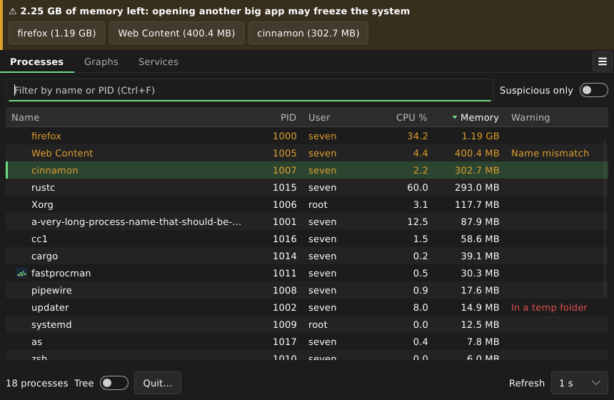
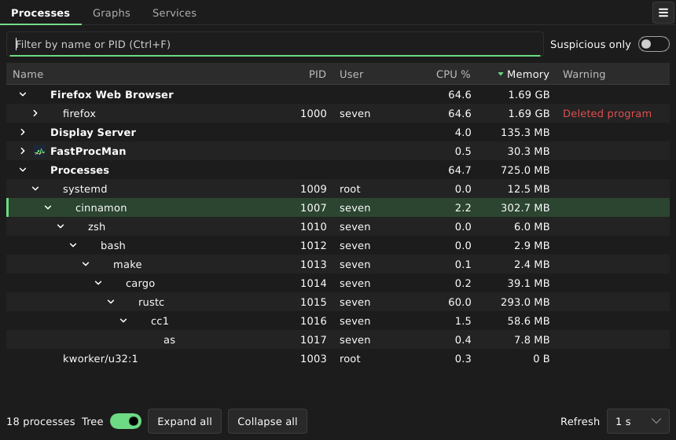
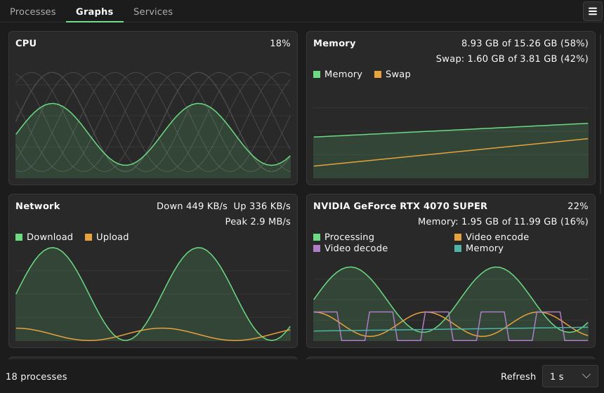
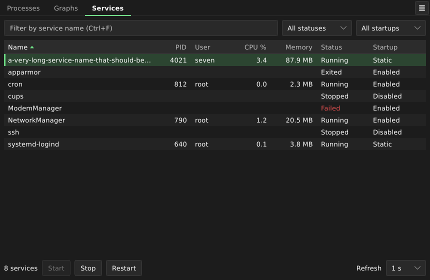

# FastProcMan

[](https://github.com/evandro777/FastProcMan/actions/workflows/ci.yml)
[](https://github.com/evandro777/FastProcMan/actions/workflows/flatpak.yml)
[](https://github.com/evandro777/FastProcMan/actions/workflows/appimage.yml)
[](https://github.com/evandro777/FastProcMan/actions/workflows/virustotal.yml)
[](https://www.linux.org/)
[](https://opensource.org/licenses/GPL-3.0)

Light and fast Linux process manager built with Rust + [Slint](https://slint.dev) (software renderer, no GL). About 30 MB of RAM (about 50 MB with an NVIDIA card, whose driver library is loaded) and about 3% of one core at the default 1 s refresh.

Landing page: <https://evandro777.github.io/FastProcMan/> (published by the Flatpak workflow on the first tag).









(Screenshots use made-up data.)

## Features

- **Processes:** name, PID, user, CPU % and memory of every process, with icons. Sort by any column, or just start typing to filter by name or PID. A **Tree** switch groups processes by application, like Mission Center.
- **Quit, force quit, suspend, priority and properties** from the right-click menu or the keyboard. Quit and force quit always ask first; other users' processes ask for the password through polkit (`pkexec`). PID 1 and FastProcMan itself are refused.
- **Suspicious processes:** a Warning column flags programs deleted from disk while running, or running from `/tmp`, and a filter shows only those.
- **Slowdown warning:** a banner warns before the system freezes (low memory, busy disk or CPU) and names the likely culprits, one click from selecting them. It never ends anything by itself.
- **Graphs:** the last minute of CPU (and each core), memory and swap, network, GPU (NVIDIA or AMD) and each disk.
- **Services:** the systemd services with status and startup state; start, stop and restart them (stop and restart ask first).
- English and Brazilian Portuguese, a CPU % scope setting, and a remembered window size.

Every feature in detail, with the shortcuts: [`docs/FEATURES.md`](docs/FEATURES.md).

## Install

### Flatpak

> **Warning: this Flatpak is not sandboxed.** A process manager inside a sandbox only sees its own processes, so the app has the permission `--talk-name=org.freedesktop.Flatpak` and uses it to start itself on the host (`flatpak-spawn --host`), like Mission Center (`io.missioncenter.MissionCenter`) does. From then on it can do anything you can do. It runs with the Flatpak runtime's own libraries, so what you install on the host does not matter. Check it with `flatpak info --show-permissions io.github.evandro777.FastProcMan`. If you do not want that, use the AppImage, or remove the permission with `flatpak override --user --nosession-bus-talk-name=org.freedesktop.Flatpak io.github.evandro777.FastProcMan` (the app then runs inside the sandbox, shows only its own processes and says so in the status line).
>
> Not tested on a real desktop yet: polkit (the password prompt for other users' processes) may behave differently when the app is started this way. It is also the reason this is not on Flathub, which does not accept the permission.

#### Install from file (no updates)

Download `FastProcMan-<version>-x86_64.flatpak` from [Releases](https://github.com/evandro777/FastProcMan/releases), then execute:

```bash
flatpak install --user ~/Downloads/FastProcMan-<version>-x86_64.flatpak
```

Installing from file, will not auto update.

#### Install with automatic updates

Every release is also published as a Flatpak remote, so `flatpak update` (or your software centre) keeps FastProcMan current. A `.flatpak` file downloaded from Releases is a one-off install: to get updates, add the remote below.

```bash
flatpak remote-add --system --if-not-exists fastprocman https://evandro777.github.io/FastProcMan/fastprocman.flatpakrepo
flatpak install --system fastprocman io.github.evandro777.FastProcMan
```

**`--system` vs `--user` matters for updates.** Linux Mint's Update Manager (and probably other software centres) only looks at *system-wide* Flatpaks; a `--user` install never appears there. With `--user`, update by hand: `flatpak update --user` (a plain `flatpak update` only checks the system installation).

The remote is GPG-signed (system-wide installs refuse unsigned remotes), but the key lives in this same repository, so it is only as trustworthy as the repository it is built from. It needs the Flathub remote for the runtime (`flatpak remote-add --if-not-exists flathub https://dl.flathub.org/repo/flathub.flatpakrepo`, with `--system` or `--user` to match).

### AppImage (with delta updates)

Download `FastProcMan-<version>-x86_64.AppImage` from [Releases](https://github.com/evandro777/FastProcMan/releases), then execute:

```bash
sudo chmod +x ~/Downloads/FastProcMan-<version>-x86_64.AppImage
~/Downloads/FastProcMan-<version>-x86_64.AppImage
```

It uses the fontconfig, xkbcommon and X11 libraries already on your system.

The AppImage does not update itself, but it has update information built in, so a tool such as [AppImageUpdate](https://github.com/AppImageCommunity/AppImageUpdate) (`appimageupdatetool FastProcMan-*.AppImage`), [Gear Lever](https://github.com/mijorus/gearlever) or [AppManager](https://github.com/kem-a/AppManager) downloads only the changed parts of the next release.

## Build & Configurations

[Build and configurations information](BUILD.md)

## Contributing and releases

See [`CONTRIBUTING.md`](CONTRIBUTING.md) to build, test and send a change, and [`RELEASING.md`](RELEASING.md) for how a release is cut. CI (format, clippy, tests, MSRV, packaging checks, and the AppImage and Flatpak builds) runs on every pull request.

## License

GPL-3.0-or-later. See [`LICENSE`](LICENSE).
